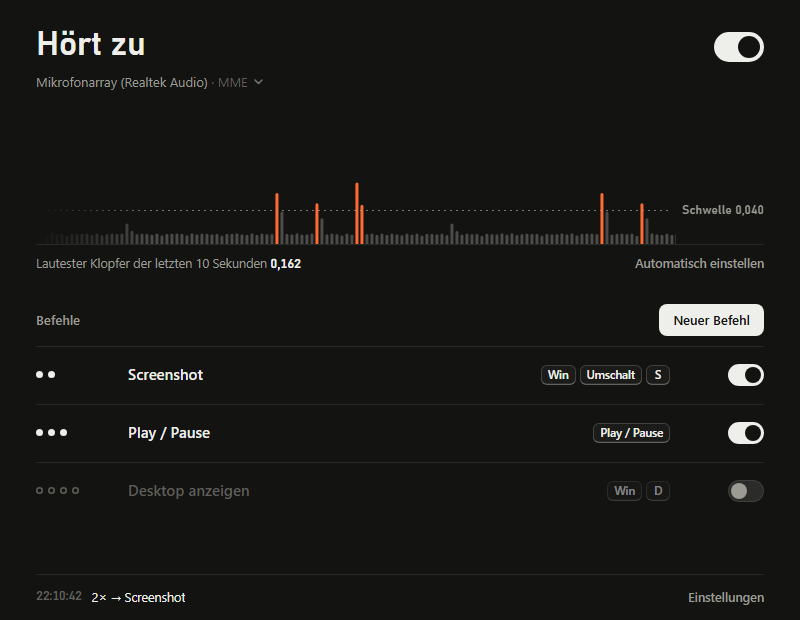

# KnockKey

Knock on the edge of your laptop – and it runs a shortcut.

KnockKey listens to the built-in microphone, detects knock patterns (2× – 6×) and triggers configurable actions: screenshots, media controls, opening programs or URLs, running commands, pasting text or locking the PC.



## Features

- **Live trace** of what the microphone hears – drag the threshold line, or let it calibrate itself
- **Live feedback** – the dots of each command light up while you knock
- Follows the Windows **light / dark** setting
- **Custom commands** for 2–6 knocks: hotkeys (recordable), open program/file/URL, shell command, paste text, lock PC
- **Presets** for common actions (screenshot, play/pause, mute, task manager, …)
- **Typing filter** – keystrokes don't trigger false knocks
- **System tray** mode and optional **autostart** with Windows
- Settings stored in `%APPDATA%\KnockKey\config.json`

## Why the microphone?

Older ThinkPads had an accelerometer (Active Protection System), but newer models such as the T470 don't expose a usable one on Windows. A knock on the chassis produces a sharp peak in the internal microphone, which works on any laptop.

## Quick start (Windows)

```bash
pip install -r requirements.txt
python knockkey.py
```

1. Pick your microphone below the headline.
2. Click **Automatisch einstellen** (auto-calibrate) and knock three times.
3. Knock twice → screenshot tool opens.

Start hidden in the tray: `python knockkey.py --tray`

## Build a standalone .exe

Double-click `build_exe.bat` → `dist\KnockKey.exe`.

## Minimal CLI version

`simple/knock.py` is the original single-file script without UI:

```bash
python simple/knock.py --list                      # show audio devices
python simple/knock.py --calibrate --device 1      # show input levels
python simple/knock.py --device 1 --threshold 0.04
```

## Tech

Python · pywebview (the interface is plain HTML/CSS/JS in `ui/index.html`, shown via Edge WebView2) · sounddevice (PortAudio) · NumPy · pynput · PyAutoGUI · pystray
